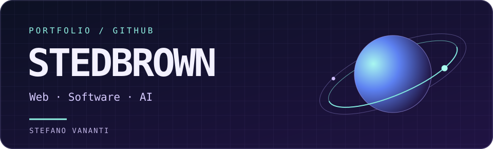

## Ciao, sono Stefano 👋

Sviluppo siti web e sperimento con AI vocale, automazioni e API. Qui raccolgo progetti per attività locali e prototipi con cui provo nuove idee.

## In evidenza

| Progetto | Cosa trovi |
| :--- | :--- |
| **[Pizzer-IA](https://github.com/stedbrown/pizzer-ia)** | Centralinista telefonico AI con sipcall/Asterisk, OpenAI Realtime, PostgreSQL e una dashboard per i log in diretta. |
| **[Alley Cat Studio](https://github.com/stedbrown/alley-cat-studio)** | Studio creativo dedicato al web design cinematografico, all’e-commerce e al software su misura. |
| **[UP Informatica](https://github.com/stedbrown/up-informatica)** | Il sito web di UP Informatica. |
| **[Lunar API Service](https://github.com/stedbrown/lunar-api-service)** | Un esperimento con API a tema lunare. |
| **[UP Informatica Bot](https://github.com/stedbrown/upinformaticabot)** | Il progetto bot di UP Informatica, in Python. |

`TypeScript` · `Python` · `HTML` · `PostgreSQL` · `Asterisk`

[Esplora tutti i repository →](https://github.com/stedbrown?tab=repositories)
